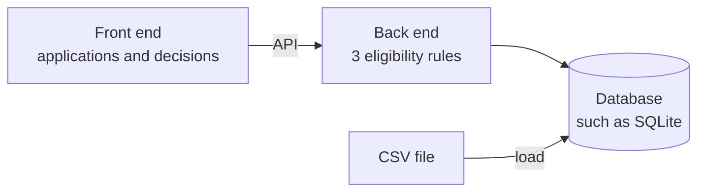

# Kuwait GitHub Copilot Hackathon - Nov 2026

    

🎯 **Your mission:** help a credit officer decide loan applications consistently, and give every applicant a clear reason.

> [!IMPORTANT]
> Synthetic data only. Never bring real customer data, credentials or production systems into this repo.

## 💼 The business problem

**The problem:** a bank's credit officers check personal-loan applications by hand, so similar applicants can get different answers, refused applicants don't learn why and auditors can't see how a decision was made.

**Why it matters:** banks must lend responsibly and treat applicants fairly. An unexplained refusal frustrates customers, and a decision nobody can reconstruct fails an audit.

## 🧰 What you'll build

You get a month of personal-loan applications. Your app takes each application, checks it against three eligibility rules and approves or rejects it, with the result of every rule and an audit trail of every step.



Build it in three parts: a database, a back end that runs the rules and records every step behind an API, and a front end that does everything through that API.

**The data**

| File | Rows | What it represents |
|---|---:|---|
| [`loan_applications.csv`](data/loan_applications.csv) | 402 | Personal-loan applications submitted in October 2026: when each one arrived (`submitted_at`), the applicant's date of birth (`date_of_birth`), their monthly income and existing monthly repayments (`monthly_income_kwd`, `existing_monthly_debt_kwd`) and the loan they want: amount, term and interest rate (`loan_amount_kwd`, `term_months`, `annual_rate_pct`) |

All data is synthetic. Applicants are anonymised IDs, with no names or civil ID numbers. The [data dictionary](data/README.md) explains every column and the data-quality issues.

**The workflow**

An application has three states: `SUBMITTED`, then `APPROVED` or `REJECTED`. Invalid input is refused at submission with a validation error. That isn't a decision, so it never becomes `REJECTED`.

| Method | Path | Purpose |
|---|---|---|
| `POST` | `/applications` | Submit and validate an application. Returns its ID with status `SUBMITTED`. |
| `POST` | `/applications/{id}/decision` | Run the rules and record the decision. |
| `GET` | `/applications/{id}` | The application, its status and the decision reasons. |
| `GET` | `/applications/{id}/audit` | The audit trail. |

The API shape is a suggestion. Agree your own API standards as a team and put them in `.github/copilot-instructions.md`.

**The eligibility rules**

| The credit officer asks | Rule ID | How to check it in the data | Suggested default |
|---|---|---|---|
| Does the applicant earn enough? | `MIN_INCOME` | Compare `monthly_income_kwd` with the limit. | 500.000 KWD or more |
| Can they afford the new repayment? | `DEBT_TO_INCOME` | Add the new monthly instalment to `existing_monthly_debt_kwd`, then divide by `monthly_income_kwd`. | 40% or less |
| Is their age within the lending limits? | `AGE` | Work out the applicant's age from `date_of_birth`, on the application date and on the last instalment date. | 21 or older on the application date, and 65 or younger on the last instalment date |

Approve an application only if every rule passes. A rejection lists every rule that failed, not just the first.

Use these definitions:

- **Monthly instalment** = P × r ÷ (1 − (1 + r)<sup>−n</sup>), where P = `loan_amount_kwd`, r = `annual_rate_pct` ÷ 1200 and n = `term_months`. If the rate is 0, the instalment is P ÷ n. Round the instalment to 3 decimal places (half up) before you compute the ratio.
- **Age** is in completed years.
- **The application date** is the date part of `submitted_at`, in Kuwait time (UTC+03:00).
- **The last instalment date** is the application date plus `term_months` calendar months. If that day doesn't exist in the target month, use the month's last day. For example, 31 October + 4 months is 28 February, or 29 February in a leap year.

The defaults are a starting point for illustration, not regulatory limits. You can change them if you record the change in your plan and test it. Keep limits in configuration, not in code.

Decide these in your plan and cover them with tests:

- **Explainability:** what the applicant and the credit officer see for each rule, for example `DEBT_TO_INCOME: 46.2% is above the 40% limit`.
- **Validation:** what makes an application invalid rather than rejected, and the error the caller gets.
- **Audit trail:** who did what and when, the inputs, each rule's result and the rule configuration used. The trail is append-only: entries are never updated or deleted.
- **Boundaries:** test values exactly at the limits, such as 500.000 KWD, a ratio of exactly 40%, a 21st birthday on the application date and a last instalment on the applicant's 66th birthday.
- **Messy data:** the data has deliberate quality issues. See [Things to know](data/README.md#things-to-know).

**What the credit officer sees:** for each application, the decision and each rule's result with the actual values, and an audit trail of who did what and when.

### Deliverables

Every challenge has the same five deliverables, sized for a team of 5–8 in 1.5–2 hours.

- [ ] **Database:** load [`loan_applications.csv`](data/loan_applications.csv) into a database, for example SQLite, through your API or an import script, and handle the issues in [Things to know](data/README.md#things-to-know).
- [ ] **Back end:** the three eligibility rules, with their limits in configuration, not in code, and an append-only audit trail for each application.
- [ ] **API:** endpoints to submit and decide an application, and to read it, its decision with each rule's result and the actual values, and its audit trail.
- [ ] **Front end:** screens to submit an application and see its decision, reasons and audit trail, all through the API.
- [ ] **Tests:** automated tests for each rule and each endpoint, including values exactly at the limits and invalid input.

The [Copilot starter kit](#-your-copilot-starter-kit) has a skill for the database, `/data-import`, and one for the API, `/api-endpoint`.

Use any language, framework and database, as long as it runs locally from your README. SQLite is a good default: it's a single file and needs no server. No machine learning is needed: plain business rules only.

## 🚀 Start here

1. Choose a team name.
2. Select **Use this template** > **Create a new repository** to create your team's copy, and include your team name in the repository name. Make it public, or give your trainer access.
3. Clone it and open it in your IDE with GitHub Copilot Chat.
4. Read this brief and the [data dictionary](data/README.md).
5. **Before you build**, plan with Copilot Plan mode and estimate your AI Credits per phase in [docs/ai-credit-budget.md](docs/ai-credit-budget.md).
6. Fill in the TODOs in [`.github/copilot-instructions.md`](.github/copilot-instructions.md) with your stack and conventions, and look through the rest of the [Copilot starter kit](#-your-copilot-starter-kit).
7. Build, test, review and document with Copilot. Commit often: your commit history is evidence.
8. Before your demo, complete [Your solution](#-your-solution) at the end of this README.

## 🧩 Your Copilot starter kit

Your repo comes with a starter kit in `.github/` that customizes Copilot for this project. Use it, change it and add to it.

| File | What it is | How to use it |
|---|---|---|
| [`.github/copilot-instructions.md`](.github/copilot-instructions.md) | Instructions: your stack and conventions. Copilot adds them to every request. | Replace the TODOs before you build. |
| [`.github/agents/reviewer.agent.md`](.github/agents/reviewer.agent.md) | Custom agent: reviews your code but can't edit it. | Select **Reviewer** from the **Agent** dropdown in Copilot Chat. |
| [`.github/skills/data-import/`](.github/skills/data-import/SKILL.md) | Skill: loads the files in `data/` into your database. It's unfinished on purpose: the first run writes a data profiler in your language. | Type `/data-import`, or ask Copilot to load the data. |
| [`.github/skills/api-endpoint/`](.github/skills/api-endpoint/SKILL.md) | Skill: adds API endpoints that follow your conventions, starting with the contract. | Type `/api-endpoint`, or ask Copilot to add an endpoint. |

Add your own skills for tasks you repeat, such as writing tests: your trainer looks for skills you wrote. The [Copilot customization guide](docs/copilot-customization.md) explains how the parts work together and how to make your own.

## 📅 The day at a glance

The day has two goals:

1. Use GitHub Copilot's Plan mode, agent mode, instructions, skills and chat review.
2. Build the habit of planning AI Credit consumption before you start prompting.

| | |
|---|---|
| **Team** | 5–8 developers |
| **Build time** | 1.5–2 hours |
| **Usage checkpoints** | Your trainer records each team member's AI Credit usage at the start of the build, at the mid-point check and at the end. |
| **Demo** | 5 minutes, then Q&A |
| **Scoring** | 100 points. See the [scoring rubric](#-scoring-rubric). |

## 🤖 Copilot focus for this challenge

Every team should use the practices the rubric scores: Plan mode, agent mode, a `.github/copilot-instructions.md` file with your team's conventions, reusable skills and Copilot Chat review. This challenge puts extra weight on three of them:

| Practice | How to apply it here |
|---|---|
| **Instructions file for API standards** | Put your API conventions in `.github/copilot-instructions.md`: resource names, status codes, the error format, validation, money as decimals and audit fields. Then every endpoint that agent mode writes follows them. |
| **Agent scaffolding** | Use agent mode to scaffold the database, the API, the audit trail, the front end and an import script for the CSV. |
| **Skills for tests** | Save reusable skills in `.github/skills/` for rule tests and API tests. Reuse them for each new rule or endpoint. |

<details>
<summary>Example prompts</summary>

**Instructions file**

```text
Fill in the TODOs in .github/copilot-instructions.md for our loan eligibility API. Cover
resource names, status codes, one error format for validation errors, money as decimals
with 3 places and the fields every audit entry must have. Keep it short enough to read
in two minutes.
```

**Rule tests** (for example, saved as `.github/skills/rule-tests/SKILL.md`)

```text
Write unit tests for the eligibility rule in the current file. Cover a pass, a fail, the
values exactly at the limit and the data-quality issues described in data/README.md.
Check that each reason includes the actual values. Follow our test conventions.
```

**Plan mode**

```text
Read README.md and data/README.md. Plan the database, a back end with an API for the
three rules, input validation and an append-only audit trail, and a front end. For each
rule and endpoint, list acceptance criteria and edge cases. For each phase, recommend a
model tier and estimate the AI Credits it will use.
```

</details>

## 💳 AI Credit budget

Estimate AI Credits per phase before you build, then track what you actually use in [docs/ai-credit-budget.md](docs/ai-credit-budget.md). The example below is from the kickoff and assumes a team of 5–8 (950 credits is about USD 9.50). Make your own estimate: the point is the habit of estimating, not hitting an exact number.

| Phase | Copilot feature | Model tier | Budget (AI Credits) |
|---|---|---|---:|
| Plan | Plan mode / Ask | Frontier | 150 |
| Scaffold | Agent mode + instructions file | Low-cost | 100 |
| Build features | Agent / Edit mode | Mixed | 500 |
| Tests + review | Skill for tests, chat review | Low-cost | 150 |
| Docs + demo | Ask, README generation | Low-cost | 50 |
| **Total** | | | **950** |

Tips to spend smart:

- Match the model to the task. Save frontier models for planning and tricky logic, and use low-cost models for scaffolding, tests and docs.
- Keep context scoped. Attach only the files Copilot needs.
- Turn prompts you repeat into skills. Copilot reads only a skill's name and description until it needs the rest.

## 🏆 Scoring rubric

The rubric awards 100 points across the lifecycle. It's the same for every challenge, so winners are comparable.

| Stage | Points |
|---|---:|
| Plan | 15 |
| Build & quality with Copilot | 40 |
| Token efficiency | 25 |
| Impact & demo | 20 |
| **Total** | **100** |

### How scoring works

- Your trainer picks one level per stage: **Solid**, **Strong** or **Outstanding**. Each level is worth the points shown.
- Your score is the sum of the four stage scores. A stage with no evidence scores 0.
- Build & quality plus Token efficiency carry 65 points: they're the two goals of the day.
- Your trainer scores from evidence, not claims: your repo, budget sheet and demo, and the usage readings they recorded.
- Tie-break: the team with the higher Token efficiency score wins.
- Solid is the expected baseline. Most teams should reach Strong in 1.5–2 hours. Outstanding should stand out.

### Levels

| Stage | Solid | Strong | Outstanding |
|---|---|---|---|
| **Plan**<br>15 points | **5 pts**<br>Plan written with Copilot Plan mode; credit budget estimated per phase. | **10 pts**<br>Plan has acceptance criteria and a model choice per phase, with the reasoning explained. | **15 pts**<br>Plan drove the build, and the team re-planned at the mid-point check using actual usage. |
| **Build & quality with Copilot**<br>40 points | **16 pts**<br>Agent mode built the main features; `copilot-instructions.md` sets team conventions; runs end to end with tests on the core logic. | **28 pts**<br>Adds reusable skills for repeat tasks (tests, docs); edge cases tested; Copilot asked in chat to review the code and findings fixed. | **40 pts**<br>Copilot used across the whole loop (plan, build, test, review, docs); team shows where it saved the most time and where they had to correct it; another team could run it from the README. |
| **Token efficiency**<br>25 points | **10 pts**<br>Usage tracked; actual within ±30% of budget. | **18 pts**<br>Within ±15% of budget; models matched to tasks; context kept scoped. | **25 pts**<br>A concrete before/after where a prompt, context or model change cut credits without hurting the output. |
| **Impact & demo**<br>20 points | **8 pts**<br>Clear user and problem; working demo in 5 minutes. | **14 pts**<br>Rules or workflow are realistic for the business; Q&A handled well. | **20 pts**<br>Credible path to a real pilot; your trainer can picture it being used. |

### What your trainer looks at

| Stage | Evidence |
|---|---|
| Plan | `docs/plan.md` from Plan mode, and the budget and mid-point re-plan in `docs/ai-credit-budget.md` |
| Build & quality | `.github/copilot-instructions.md`, `.github/skills/`, tests, commit history and this README |
| Token efficiency | Budget versus actual usage in `docs/ai-credit-budget.md`, checked against your trainer's readings, and your before/after example |
| Impact & demo | Your 5-minute demo and Q&A |

### Clarifications

- **Token efficiency isn't about using the fewest credits.** It's scored against your own budget plus proof of optimization, so a team that barely used Copilot can't win it by spending little. Your trainer rewards value delivered per credit. The ±30% and ±15% bands apply to overspending and underspending.
- **IDE features are enough.** Every level can be reached with Copilot Chat features in the IDE: Plan mode, agent mode, instructions, skills and chat review. Skills need VS Code, Visual Studio or a JetBrains IDE.

## ✅ Your solution

> [!NOTE]
> Complete this section before your demo. Your trainer, and other teams, will run your app from it.

- **Team name:**
- **Team members:**
- **Stack:**

### Run it

```bash
# Replace with the exact steps to install and run your app.
```

### Test it

```bash
# Replace with the exact command that runs your tests.
```

### Rule-to-test traceability

| Rule | Implemented in | Tested in |
|---|---|---|
| `MIN_INCOME` | | |
| `DEBT_TO_INCOME` | | |
| `AGE` | | |
| Input validation | | |

### Copilot retrospective

- **Where Copilot saved us the most time:**
- **Where we had to correct it:**

### Evidence checklist

- [ ] Plan: `docs/plan.md`
- [ ] Budget, usage readings, mid-point re-plan and before/after example: [`docs/ai-credit-budget.md`](docs/ai-credit-budget.md)
- [ ] Team conventions: `.github/copilot-instructions.md`
- [ ] Skills you wrote: `.github/skills/`
